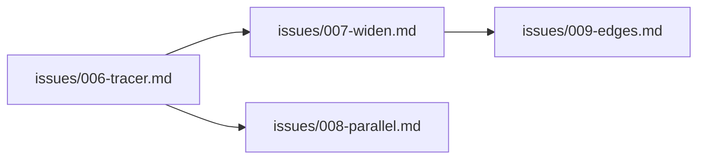

# Vertical slice heuristics

Quick reference when breaking a PRD into issues.

## Tracer bullet checklist

The first issue should:

- [ ] Touch every **layer** the feature needs (even if some layers are minimal/stubbed)
- [ ] Deliver one **happy path** a human or agent can demo
- [ ] Use **real** integration points (auth, routing, DB) where they exist — avoid mocks that hide wiring risk
- [ ] Stay **small** — hours to a day, not a week
- [ ] Name the **widening** issues it unlocks (002, 003, …)

## Sizing guide

| Size | Signal | Action |
|------|--------|--------|
| Too big | Multiple unrelated flows, "and also", no single demo | Split by user outcome |
| Right | One demo, one primary flow, clear done state | Ship as one issue |
| Too small | No E2E proof; pure refactor with no behavior change | Merge with next slice or add minimal wiring |

## Ordering patterns

1. **Tracer bullet** → **happy path completeness** → **edge cases** → **polish / P1 / P2**
2. **Read path before write path** when both are needed (list before create)
3. **Deep module + thin wiring** before **UI polish** on the same flow
4. **Auth / permissions** in the tracer bullet if the feature is protected

## Dependency graph (optional working notes)

Track in Phase 3–4 working notes or the PRD — no separate README required unless the user asks.

Or a simple table:

| File | Title | Blocked by | Demo |
|------|-------|------------|------|
| issues/006-….md | … | — | … |

## IHCS monorepo reminders

- Frontend: `frontend/` — yarn, Docker for build; see `frontend/AGENTS.md`
- Backend: `backend/` — uv; see `backend/AGENTS.md`
- Graphify before exploring unfamiliar code
- Do not run `yarn build` from host; use `docker-compose`
